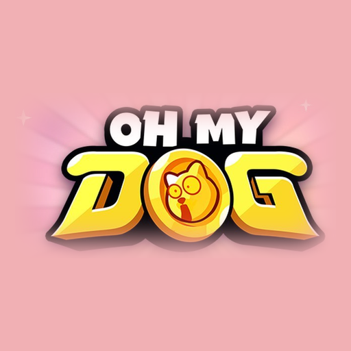
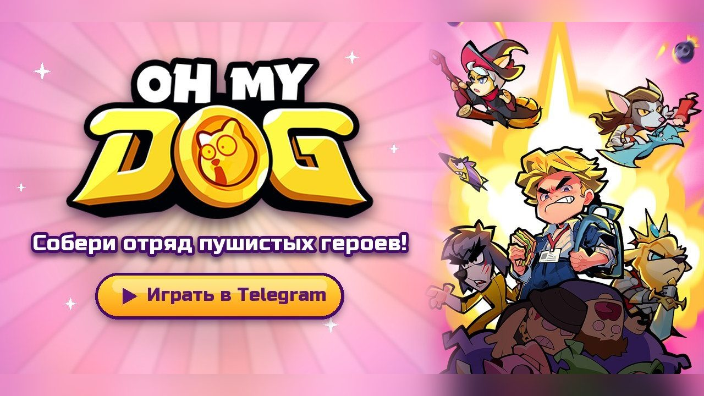
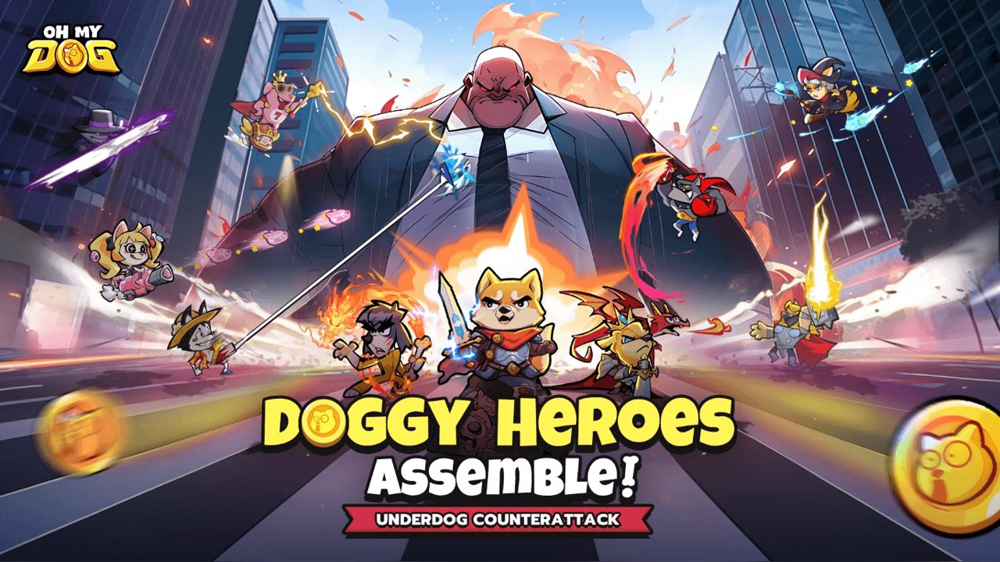
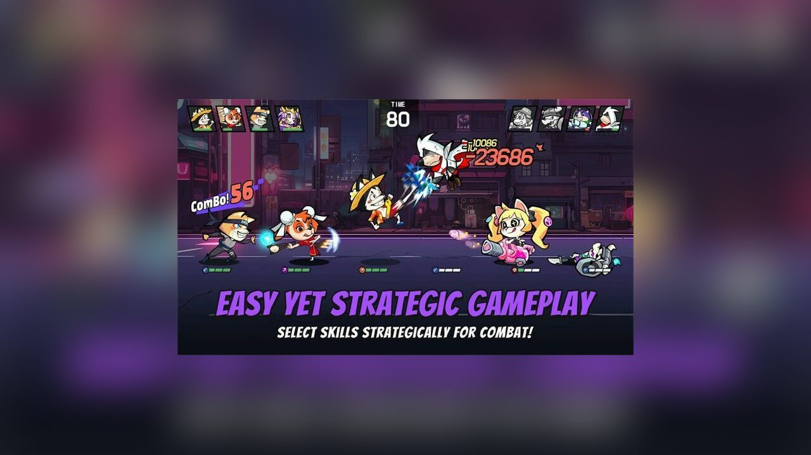
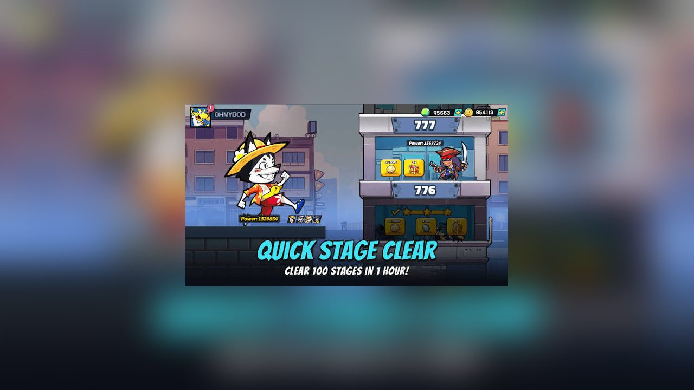
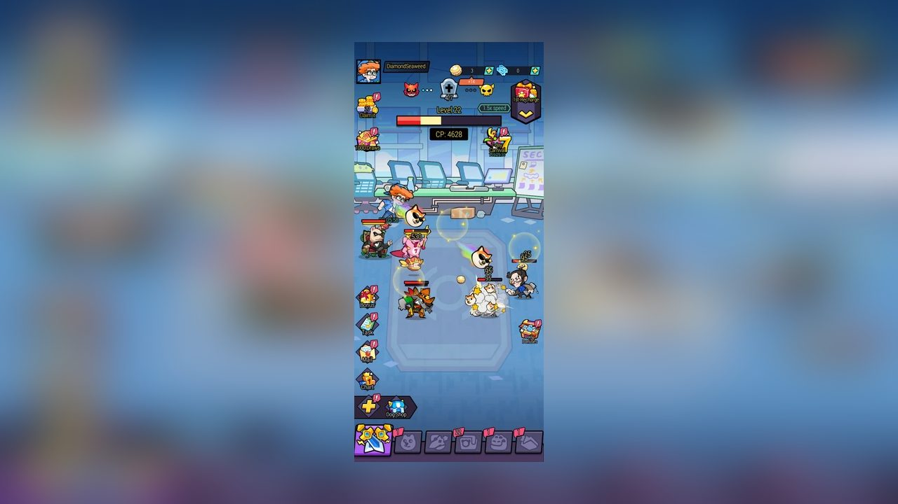
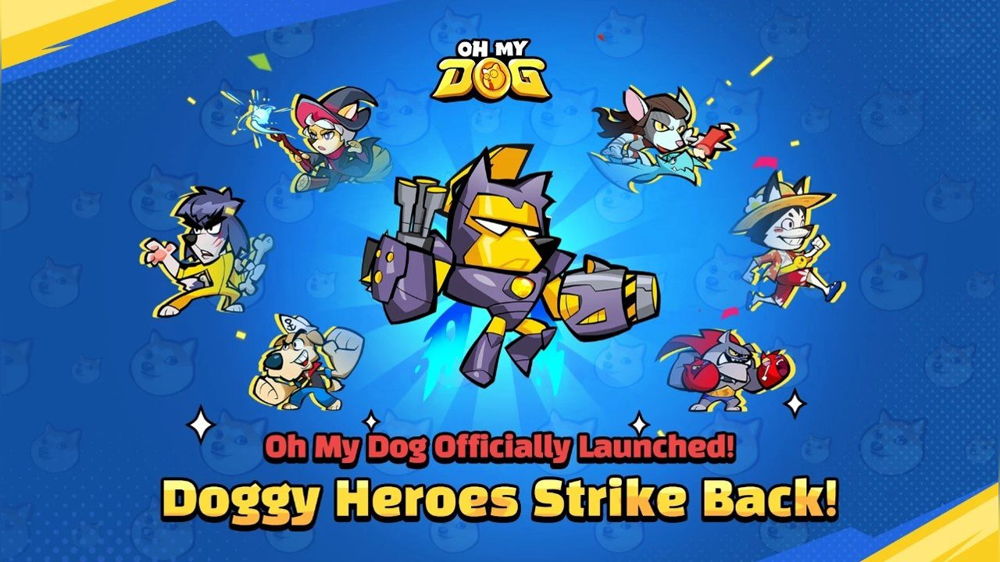
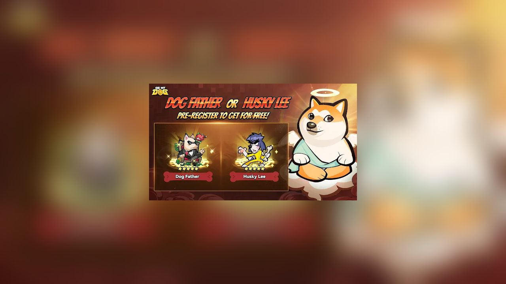
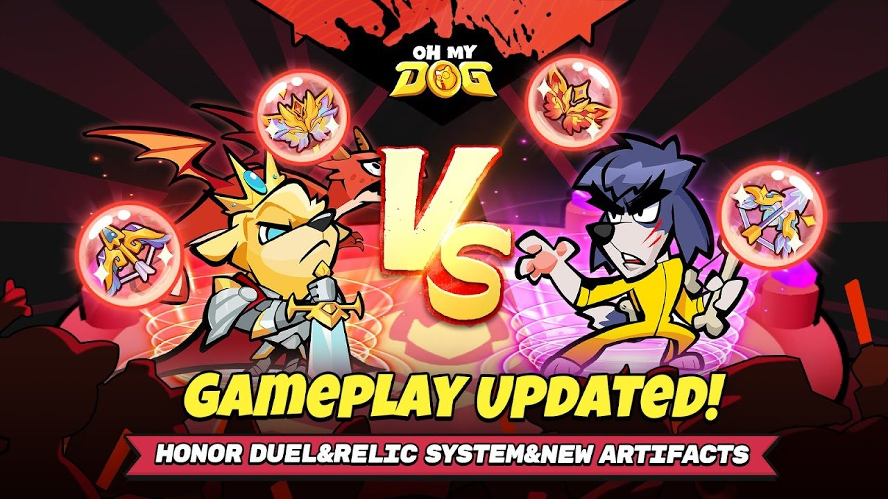

  

<h1 align="center">Oh My Dog! 🐶</h1>

  <b>Бесплатная idle / карточная RPG в Telegram — Free idle card RPG in Telegram</b> 
  <a href="https://t.me/OhMyDogMobileBot">▶ https://t.me/OhMyDogMobileBot</a> ·
  <a href="https://ohmydog.gg">🌐 https://ohmydog.gg</a>
   <a href="https://ohmydog.gg/game/game.html">Играть в браузере / Play in browser: https://ohmydog.gg/game/game.html</a>

  

**Languages / Языки:** [🇷🇺 Русский](#-русский) · [🇬🇧 English](#-english)

---

## 🇷🇺 Русский

### Что это такое

**Oh My Dog!** — бесплатная idle-RPG с коллекционными картами героев, которая работает прямо внутри Telegram. Никаких скачиваний из магазина и отдельной регистрации: открываешь бота, нажимаешь «Играть» — и аккаунт создаётся сам и привязывается к твоему Telegram.

- 🤖 Бот: https://t.me/OhMyDogMobileBot
- 🌐 Сайт: https://ohmydog.gg
- 💸 Цена: бесплатно
- 🎁 Для новых игроков сейчас идёт акция: **1000 бесплатных призывов**
- 🌍 Языки: русский, английский

> Это репозиторий-витрина: здесь нет исходного кода игры, только описание, картинки и ссылки, чтобы игру было проще найти и показать друзьям.

  

### Сюжет

Ты — обычный уставший офисный работник. Дедлайн горит, начальник срывается, коллеги сваливают на тебя свои задачи. И в самый тяжёлый момент появляется **говорящий Собачий Бог**. Он заявляет, что хватит это терпеть, и призывает к тебе армию — от **50 до 100 собак-воинов** с суперсилами. Среди героев, например, Dog Father и Husky Lee — по названиям понятно, на что мы намекали. Вместе с ними ты даёшь отпор офисным задирам.

История подана с юмором: это не мрачное фэнтези, а лёгкая сатира про офисную жизнь, где главными героями становятся собаки.

### Как играется

Основа — idle и карточная RPG:

1. **Собираешь отряд.** Героев-собак много, у каждого своя внешность, роль в бою и уникальная способность. Кто-то держит удар, кто-то наносит урон, кто-то поддерживает команду.
2. **Бои идут автоматически.** Тебе не нужно часами нажимать на экран: решения принимаются до боя — кого поставить в команду, какую экипировку надеть, каких питомцев закрепить за героем.
3. **Прогресс идёт даже офлайн.** Закрыл чат — отряд всё равно продолжает набираться сил. Вернулся — забрал награды и усилил героев.
4. **Растёшь вместе с отрядом.** Уровни, экипировка и питомцы делают героев сильнее, а значит открывают путь к более сложным боссам и подземельям.

  

### Возможности

| Возможность | Описание |
|---|---|
| Коллекция героев | От 50 до 100 собак-воинов с уникальными способностями |
| Автобои | Сражения идут сами, ты управляешь составом |
| Офлайн-прогресс | Награды копятся, пока ты занят делами |
| Питомцы и экипировка | Усиление каждого героя |
| PvP-арена | Бои против отрядов других игроков |
| Боссы и подземелья | Отдельные испытания с наградами |
| Альянсы и гильдии | Командные битвы вместе с друзьями |
| Старт в один клик | Аккаунт создаётся автоматически и привязывается к Telegram |

  

### Почему Telegram

Раньше игра выходила как обычное мобильное приложение: страница в магазине, установка, регистрация. Мы решили убрать магазин из середины пути к игроку. В Telegram:

- вход занимает одну кнопку — никаких паролей и подтверждения почты;
- игра работает на телефоне и на компьютере, везде, где есть Telegram, с одним и тем же прогрессом;
- альянсы и гильдии ощущаются естественнее — друзья уже в мессенджере, достаточно скинуть ссылку в чат;
- idle-формат хорошо ложится на короткие сессии: открыл чат, забрал награды, поменял состав — и вернулся к делам.

Важно: мы не делали «тапалку ради токена». Мы перенесли настоящую RPG с прокачкой, сюжетом и PvP и хотим, чтобы она оставалась игрой.

  

### Как начать играть

1. Установи Telegram (если ещё не установлен) — на телефон или компьютер.
2. Открой https://t.me/OhMyDogMobileBot.
3. Нажми **«Играть»** (Start / Play).
4. Забери 1000 бесплатных призывов для новых игроков и собери первый отряд.
5. Зови друзей в альянс — ссылкой на бота: https://t.me/OhMyDogMobileBot.

### Для игроков с короткими перерывами

Есть пять минут между созвонами? Этого хватит: забрать накопленные награды, надеть новую экипировку, повысить уровень любимому псу и запустить следующий бой. А если времени больше — к твоим услугам арена, боссы, подземелья и гильдейские битвы.

  
  

### Ссылки

- Играть: https://t.me/OhMyDogMobileBot
- Сайт: https://ohmydog.gg

### Обратная связь

Нам важен отзыв от тех, кто разбирается в играх: что нравится, что раздражает, где непонятно. Оставляй идеи в Issues этого репозитория или пиши нам через бота https://t.me/OhMyDogMobileBot.

---

## 🇬🇧 English

### What is it

**Oh My Dog!** is a free idle / card RPG that runs directly inside Telegram. There is nothing to download from a store and no separate sign-up: open the bot, press **Play**, and an account is created automatically and bound to your Telegram account.

- 🤖 Bot: https://t.me/OhMyDogMobileBot
- 🌐 Website: https://ohmydog.gg
- 💸 Price: free
- 🎁 Right now new players get **1000 free summons**
- 🌍 Languages: Russian, English

> This is a showcase repository: it contains no game source code, only a description, pictures and links so the game is easier to find and share.

  

### Story

You are an ordinary exhausted office worker. The deadline is burning, the boss is shouting, colleagues keep dumping their tasks on you. At the lowest point a **talking Dog God** appears. He says enough is enough and summons an army of **50 to 100 dog warriors** with superpowers. Heroes such as Dog Father and Husky Lee hint at what we were winking at. Together you stand up to the office bullies.

The tone is humorous: this is not grim fantasy but a light satire of office life where dogs are the heroes.

### Gameplay

The core is an idle card RPG:

1. **Build a squad.** There are many dog heroes, each with its own look, battle role and unique ability: some tank, some deal damage, some support.
2. **Battles run automatically.** You do not have to tap the screen for hours; decisions are made before the fight — who joins the team, which gear to equip, which pets to assign.
3. **Progress continues offline.** Close the chat and the squad keeps getting stronger. Come back, collect rewards and upgrade your heroes.
4. **Grow with your squad.** Levels, equipment and pets make heroes stronger and open the way to harder bosses and dungeons.

### Features

| Feature | Description |
|---|---|
| Hero collection | 50–100 dog warriors with unique abilities |
| Auto-battles | Fights run by themselves, you manage the lineup |
| Offline progress | Rewards accumulate while you are busy |
| Pets and equipment | Power up every hero |
| PvP arena | Fight squads of other players |
| Bosses and dungeons | Separate challenges with rewards |
| Alliances and guilds | Team battles with friends |
| One-click start | The account is created automatically and bound to Telegram |

### Why Telegram

The game first shipped as a regular mobile app: a store page, an install, a registration. We decided to take the store out of the middle of the player's path. In Telegram:

- entry is a single button — no password and no email confirmation;
- it works on phones and on desktop, anywhere Telegram runs, with the same progress;
- alliances and guilds feel natural — your friends are already in the messenger, just send them a link;
- the idle format fits short sessions: open the chat, collect rewards, change the lineup, go back to your day.

We did not build a "tap for a token" clicker. We moved a real RPG with progression, a story and PvP, and we want it to stay a game.

### How to start

1. Install Telegram (phone or desktop) if you do not have it.
2. Open https://t.me/OhMyDogMobileBot.
3. Press **Play** / Start.
4. Claim the 1000 free summons for new players and assemble your first squad.
5. Invite friends into an alliance by sharing https://t.me/OhMyDogMobileBot.

### Links

- Play: https://t.me/OhMyDogMobileBot
- Website: https://ohmydog.gg

### Feedback

Feedback from people who know games is very welcome: what you like, what annoys you, what is unclear. Open an Issue in this repository or reach us through the bot: https://t.me/OhMyDogMobileBot.

---

  <b>Oh My Dog!</b> — <a href="https://t.me/OhMyDogMobileBot">https://t.me/OhMyDogMobileBot</a> · <a href="https://ohmydog.gg">https://ohmydog.gg</a>

*Keywords: telegram game, telegram mini app game, idle rpg, card rpg, dog heroes, free to play, telegram bot game, игра в телеграм, idle игра, собаки.*
